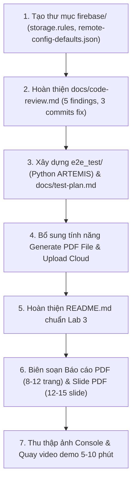

# ĐÁNH GIÁ HIỆN TRẠNG & KẾ HOẠCH BỔ SUNG HOÀN THIỆN LAB 3
**Môn học:** PRM393 – Mobile Programming (Lab 3: Cloud-Enabled Mobile App)  
**Tài liệu đối chiếu:** 
1. `PRM393 - Lab 3 Cloud-Enabled Mobile App (Firebase, Patrol, AI Code Review).pdf` (Bản đặc tả chính thức 18 trang)
2. `PRM393_Lab3_Preparation_Guide_v5_ToiUu.pdf` (Hướng dẫn chuẩn bị thực hành 25 trang)  
**Mã nguồn đối chiếu:** Thư mục dự án `prm323-lab3-SE192947`  
**Ngày thực hiện:** 06/11/2026  

---

## I. TỔNG QUAN HIỆN TRẠNG DỰ ÁN

Dự án hiện tại đã xây dựng được một nền tảng mã nguồn Flutter rất tốt theo mô hình MVVM, giao diện bám sát 100% bản thiết kế Figma (Lab 2), và đã tích hợp cơ bản 6 dịch vụ Firebase. Tuy nhiên, khi đối chiếu trực tiếp với thang điểm 10 điểm (Rubric) và danh sách cấu trúc nộp bài chuẩn của Lab 3, dự án còn thiếu một số thành phần quan trọng về **quy chuẩn thư mục (firebase/, e2e_test/)**, **tài liệu kỹ thuật bắt buộc (code-review.md, test-plan.md chuẩn ARTEMIS, README.md chuẩn)**, **tính năng xuất file báo cáo (PDF/Report Export)** và **các sản phẩm nộp cuối cùng (báo cáo PDF, slide PDF, video demo)**.

---

## II. BẢNG SO SÁNH CHI TIẾT THEO CẤU TRÚC NỘP BÀI CHUẨN

Cấu trúc nộp bài bắt buộc theo quy định Lab 3 (Trang 10 - Đề bài):
```text
PRM393_Lab03_<StudentID>/
├── README.md
├── lib/
├── e2e_test/
│   ├── conftest.py
│   ├── pyproject.toml
│   └── test_*.py
├── android/ (bao gồm google-services.json)
├── firebase/
│   ├── storage.rules
│   └── remote-config-defaults.json
├── docs/
│   ├── design-traceability.md
│   ├── architecture.md
│   ├── analytics-plan.md
│   ├── test-plan.md
│   └── code-review.md
├── evidence/ (console, DebugView, Crashlytics, ARTEMIS traces & screenshots)
├── report/
│   └── Lab03_<StudentID>.pdf
└── slides/
    └── Lab03_<StudentID>_slides.pdf
```

### Bảng đối chiếu từng hạng mục:

| Hạng mục | Quy định Lab 3 | Hiện trạng trong Project | Đánh giá | Mức độ ưu tiên |
|---|---|---|:---:|:---:|
| **1. Mã nguồn Flutter (`lib/`)** | Kiến trúc MVVM, 8+ màn hình, 3 flows hoàn chỉnh, xử lý lỗi, Design System token & widget | Đã có đầy đủ màn hình, Design System chuẩn, 0 lỗi biên dịch | **ĐẠT (95%)** | Thấp |
| **2. Cấu hình Firebase (`firebase/`)** | Thư mục `firebase/` chứa `storage.rules` (chặn UID) và `remote-config-defaults.json` | **Chưa có thư mục `firebase/`** ở thư mục gốc | **THIẾU** | **CAO** |
| **3. Bộ test ARTEMIS (`e2e_test/`)** | Thư mục `e2e_test/` gồm `conftest.py`, `pyproject.toml`, các file `test_*.py` (10 test cases bằng Python ARTEMIS SDK) | **Chưa có thư mục `e2e_test/`** | **THIẾU** (Mất 1.5đ rubric nếu thiếu) | **CỰC CAO** |
| **4. `README.md`** | Hướng dẫn chạy app, API, ghim version, danh sách AI tool, link demo video, sơ đồ deliverables | Đang là file template mặc định của Flutter | **THIẾU** | **CAO** |
| **5. `docs/design-traceability.md`** | Ma trận ánh xạ màn hình, flow, component sang Flutter, bảng lý do thay đổi | Đã có đầy đủ, chi tiết | **ĐẠT (100%)** | Xong |
| **6. `docs/architecture.md`** | Mô tả cấu trúc thư mục, layer diagram (Mermaid), sequence diagram, bảng ViewModel & Service | Đã có đầy đủ (17 KB) | **ĐẠT (100%)** | Xong |
| **7. `docs/analytics-plan.md`** | Kế hoạch 7+ sự kiện GA4, bảng tham số, không PII, câu hỏi sản phẩm | Đã có đầy đủ 8 sự kiện | **ĐẠT (95%)** | Hoàn thiện nhỏ |
| **8. `docs/test-plan.md`** | Kế hoạch test E2E theo mẫu Appendix B: 10 test case ARTEMIS (happy, error, native), báo cáo phiên khám phá 15-30p | Đang là kế hoạch Unit Test cũ của Dispute (chưa có format ARTEMIS) | **CẦN LÀM LẠI** | **CỰC CAO** |
| **9. `docs/code-review.md`** | Đánh giá code bằng AI (5+ phát hiện, 2+ nhóm lỗi, lý do kỹ thuật, 3 commit fix) | **File đang rỗng (0 bytes)** | **THIẾU** (Mất 0.5đ rubric) | **CAO** |
| **10. Tính năng tạo & tải file lên Cloud** | Sinh ít nhất 1 file phản ánh nội dung người dùng đang xem (vd: PDF báo cáo/hóa đơn) và upload lên `reports/{uid}/...` | Hiện chỉ upload ảnh khiếu nại, chưa có chức năng tạo file PDF tóm tắt | **CẦN BỔ SUNG** | **CAO** |
| **11. Minh chứng (`evidence/`)** | Ảnh Console Users, Storage files, FCM 3 trạng thái, Before/After Remote Config, ARTEMIS traces | Mới có ảnh DebugView, Crashlytics, Remote Config. Thiếu ảnh Console Users, Storage, FCM, ARTEMIS | **THIẾU MỘT PHẦN** | **TRUNG BÌNH** |
| **12. Báo cáo cuối kỳ (`report/`)** | File `report/Lab03_<StudentID>.pdf` (8–12 trang đầy đủ nội dung) | Chưa có thư mục và file PDF | **THIẾU** | **CAO** |
| **13. Slide thuyết trình (`slides/`)** | File `slides/Lab03_<StudentID>_slides.pdf` (12–15 slides) | Đã có nội dung Markdown trong `docs/`, chưa render ra PDF | **CẦN XUẤT PDF** | **TRUNG BÌNH** |
| **14. Video Demo** | Video 5–10 phút quay luồng chạy thực tế kèm Firebase Console | Chưa có link video trong README.md | **CẦN QUAY** | **CAO** |

---

## III. CHI TIẾT NHỮNG NỘI DUNG CẦN LÀM NGAY

### 1. Tạo thư mục `firebase/` và các file quy chuẩn (Bắt buộc)
Cần tạo ngay ở thư mục gốc:
1. `firebase/storage.rules`:
   ```javascript
   rules_version = '2';
   service firebase.storage {
     match /b/{bucket}/o {
       match /reports/{userId}/{allPaths=**} {
         allow read, write: if request.auth != null && request.auth.uid == userId;
       }
     }
   }
   ```
2. `firebase/remote-config-defaults.json`:
   ```json
   {
     "ktx_promo_banner_enabled": true,
     "ktx_promo_banner_text": "Đồng giá ship 5.000đ giao thẳng tới Trụ A1–A2 (Cổng B2) & Khu A.",
     "ktx_group_ship_fee": 5000
   }
   ```

---

### 2. Xây dựng bộ kiểm thử E2E tự động bằng Google ARTEMIS (`e2e_test/`)
Đề bài yêu cầu chấm 1.5 / 10 điểm cho kiểm thử tự động với Google ARTEMIS. Cần bổ sung:
1. `e2e_test/pyproject.toml`: Khai báo môi trường Python, `pytest`, `pytest-asyncio`, `artemis`.
2. `e2e_test/conftest.py`: Thiết lập fixture kết nối `ArtemisClient` qua ADB tới thiết bị Android.
3. Các file test case cụ thể (tối thiểu 10 test case):
   - `e2e_test/test_auth.py`: TC-01 (Đăng nhập Google/Phone), TC-02 (Hủy đăng nhập), TC-03 (Đăng xuất).
   - `e2e_test/test_search.py`: TC-04 (Tìm kiếm món thành công), TC-05 (Tìm kiếm rỗng - error path hiển thị Empty State).
   - `e2e_test/test_order_flow.py`: TC-06 (Chọn quán, thêm món vào giỏ, chọn ca gom đơn, chuyển khoản VietQR).
   - `e2e_test/test_export.py`: TC-07 (Xuất file báo cáo/hóa đơn và upload Cloud Storage).
   - `e2e_test/test_native_interaction.py`: TC-08 (Hộp thoại xin quyền thông báo Notification Permission Android 13+).
   - `e2e_test/test_remote_config.py`: TC-09 (Kiểm tra Remote Config hiển thị đúng banner trên màn hình).
   - `e2e_test/test_dispute.py`: TC-10 (Báo cáo sự cố món hỏng, kiểm tra lỗi khi thiếu ảnh).

---

### 3. Cập nhật `docs/test-plan.md` theo chuẩn Appendix B
Viết lại file `docs/test-plan.md` khớp với mẫu chuẩn trong đề bài (Trang 17 - Appendix B):
- Bảng ánh xạ các luồng Lab 2 vào màn hình.
- Bảng 10 test cases chi tiết: `ID`, `Flow`, `Precondition`, `Steps`, `Expected Result`, `Type` (Happy path, Error path, Native interaction), `Result` (Pass rate 3/3).
- Báo cáo **Phiên kiểm thử khám phá (Exploratory Testing Session)**: Thực hiện không kịch bản kéo dài 15–30 phút và danh sách các lỗi/vấn đề phát hiện được.

---

### 4. Viết nội dung `docs/code-review.md` theo chuẩn Appendix C
Hiện tại file `docs/code-review.md` đang rỗng (0 bytes). Cần điền đầy đủ:
1. **Công cụ AI Review đã dùng:** CodeRabbit, GitHub Copilot hoặc SonarCloud.
2. **Bảng 5+ phát hiện (Findings):** Gắn với `File:line`, thuộc các nhóm lỗi:
   - Architecture (Vi phạm MVVM: Widget gọi trực tiếp API client hoặc logic trong build).
   - Maintainability (Hàm quá dài, mã lặp lại).
   - Security (Không validate input, lộ khóa).
   - Performance (Rebuild không cần thiết, thiếu cache).
3. **Quyết định (Decision Record):** Accepted / Modified / Rejected kèm lý do kỹ thuật chi tiết.
4. **Bằng chứng Fix:** Ít nhất 3 phát hiện được chấp nhận và sửa trong các commit riêng kèm mã commit hash (`Fix commit`).
5. **Kê khai AI Disclosure:** Danh sách các công cụ AI đã dùng trong toàn bộ Lab 3.

---

### 5. Bổ sung tính năng tạo file PDF Tóm tắt Đơn hàng & Upload Cloud
- Đề bài yêu cầu: *"Generate at least 1 file (for example a PDF summary of what the user is viewing) and upload it to the cloud under reports/{uid}/... show progress and download URL"*.
- **Cách thực hiện:** Thêm nút *"Xuất hóa đơn / Báo cáo đơn gom KTX (PDF)"* tại màn hình **Theo dõi đơn hàng (S6)** hoặc **Khu vực Demo Firebase (S13)**.
- Khi người dùng nhấn, app sinh file tóm tắt (chứa mã đơn, tên quán, danh sách món, ca gom KTX, tổng tiền), upload lên `reports/{uid}/report_<timestamp>.pdf`, hiển thị thanh tiến độ (Progress bar) và hiển thị URL tải về.

---

### 6. Cập nhật `README.md` chuyên nghiệp
Viết lại `README.md` thay thế template Flutter:
- Giới thiệu đề tài: KTX Food Ordering App (PRM393 - Lab 3).
- Thông tin sinh viên & nhóm thực hiện.
- Hướng dẫn cài đặt & chạy ứng dụng (`flutter run`).
- Hướng dẫn chạy bộ test E2E ARTEMIS (`pytest e2e_test/`).
- Ghim phiên bản các công cụ (Flutter 3.x, Dart 3.x, Firebase SDKs, Python 3.12, ARTEMIS).
- Danh sách công cụ AI sử dụng.
- Liên kết Video Demo (Google Drive / YouTube).
- Sơ đồ điều hướng đến toàn bộ các file nộp bài (Deliverables Map).

---

### 7. Xuất Báo Cáo PDF (`report/`) và Slide PDF (`slides/`)
1. **Slide thuyết trình:** Nội dung đã soạn sẵn trong `docs/LAB3_PRESENTATION_SLIDES.md` (12 slide chuẩn). Cần render ra file `slides/Lab03_SE192947_slides.pdf`.
2. **Báo cáo cuối kỳ (Final Report):** Soạn tài liệu 8–12 trang tổng hợp toàn bộ bài làm (Tổng quan, Truy vết Lab 2, Kiến trúc MVVM, 6 dịch vụ Firebase, Kiểm thử ARTEMIS, AI Code Review, Bài học kinh nghiệm) và xuất ra file `report/Lab03_SE192947.pdf`.
3. **Video Demo (5–10 phút):** Quay video trình diễn các luồng test case theo đúng thứ tự (Login -> Order -> Export/Upload -> FCM Push -> Remote Config -> Crashlytics test -> ARTEMIS run trên máy thật) và đưa link vào `README.md`.

---

## IV. LỘ TRÌNH THỰC HIỆN ĐỀ XUẤT (ACTION PLAN)



---
*Tài liệu được lập tự động dựa trên đối chiếu chi tiết 2 file hướng dẫn chính thức PRM393 Lab 3.*

