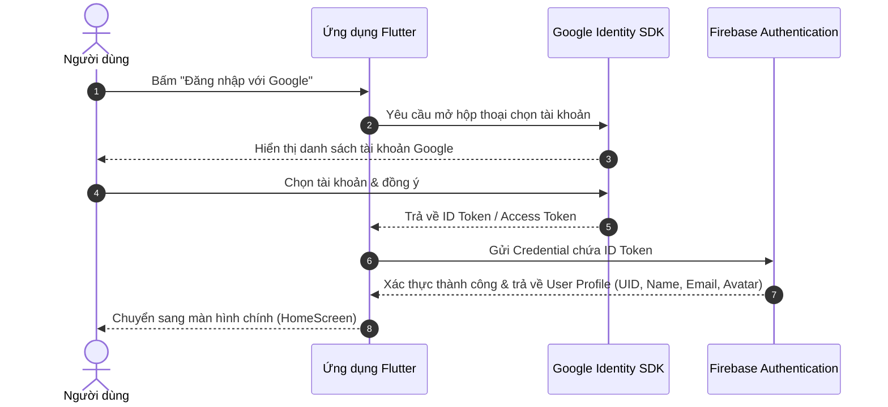

# Hướng Dẫn Cấu Hình Firebase Authentication (Google Sign-In) Từ A Đến Z Trong Flutter

Tài liệu này hướng dẫn chi tiết từng bước thiết lập tính năng **Đăng nhập bằng tài khoản Google (Google Sign-In)** tích hợp với **Firebase Authentication** cho ứng dụng Flutter (tập trung vào nền tảng Android), từ lúc tạo dự án đến khi chia sẻ dự án cho các thành viên trong nhóm tải về chạy được ngay.

---

## 📌 Mục Lục
1. [Tổng Quan Luồng Hoạt Động](#1-tổng-quan-luồng-hoạt-động)
2. [Giai Đoạn 1: Cấu Hình Trên Firebase Console](#2-giai-đoạn-1-cấu-hình-trên-firebase-console)
3. [Giai Đoạn 2: Lấy Mã SHA-1 Debug (Bắt Buộc Với Android)](#3-giai-đoạn-2-lấy-mã-sha-1-debug-bắt-buộc-với-android)
4. [Giai Đoạn 3: Cấu Hình Dự Án Android (Gradle)](#4-giai-đoạn-3-cấu-hình-dự-án-android-gradle)
5. [Giai Đoạn 4: Cài Đặt Dependencies Trong Flutter](#5-giai-đoạn-4-cài-đặt-dependencies-trong-flutter)
6. [Giai Đoạn 5: Viết Code Xử Lý Đăng Nhập / Đăng Xuất](#6-giai-đoạn-5-viết-code-xử-lý-đăng-nhập--đăng-xuất)
7. [Giai Đoạn 6: Bật Quyền Truy Cập Cho Người Dùng Ngoài (Google Cloud Audience)](#7-giai-đoạn-6-bật-quyền-truy-cập-cho-người-dùng-ngoài-google-cloud-audience)
8. [Giai Đoạn 7: Cấu Hình Shared Keystore Để Cả Team Clone Về Dùng Được Ngay](#8-giai-đoạn-7-cấu-hình-shared-keystore-để-cả-team-clone-về-dùng-được-ngay)
9. [Bảng Tra Cứu Lỗi Thường Gặp (Troubleshooting)](#9-bảng-tra-cứu-lỗi-thường-gặp-troubleshooting)

---

## 1. Tổng Quan Luồng Hoạt Động

Khi người dùng nhấn nút đăng nhập:


---

## 2. Giai Đoạn 1: Cấu Hình Trên Firebase Console

### Bước 1.1: Tạo Project Firebase
1. Truy cập [Firebase Console](https://console.firebase.google.com/).
2. Nhấn **Add project** (Thêm dự án) > Nhập tên project (Ví dụ: `prm323-lab3`).
3. Google Analytics: có thể bật hoặc tắt (tùy nhu cầu) > Bấm **Create project**.

### Bước 1.2: Bật Sign-in Method "Google"
1. Ở thanh menu bên trái, vào **Build** > **Authentication**.
2. Nhấn **Get started** nếu là lần đầu tiên truy cập.
3. Chọn thẻ **Sign-in method** > Nhấn nút **Add new provider** > Chọn **Google**.
4. Bật công tắc **Enable**.
5. Nhập **Project support email** (chọn chính email Google của bạn).
6. Nhấn **Save**.

### Bước 1.3: Thêm ứng dụng Android vào Firebase
1. Tại trang **Project Overview**, bấm vào biểu tượng Android để đăng ký app.
2. Điền thông tin:
   - **Android package name**: Lấy chính xác trong file `android/app/build.gradle.kts` (dòng `applicationId` hoặc `namespace`, ví dụ: `com.example.prm393_lab03_se192947`).
   - **App nickname**: Đặt tên tùy ý (ví dụ: `PRM Lab 3`).
3. Nhấn **Register app**.

---

## 3. Giai Đoạn 2: Lấy Mã SHA-1 Debug (Bắt Buộc Với Android)

> [!IMPORTANT]
> Google Sign-In trên Android bắt buộc phải có chữ ký số (SHA-1) để Google cấp phép xác thực ứng dụng. Nếu thiếu SHA-1, bạn sẽ gặp lỗi `ApiException: 10` hoặc `12500`.

### Bước 2.1: Chạy lệnh lấy mã SHA-1 máy cá nhân
Mở Terminal tại thư mục dự án và chạy:
```powershell
cd android
./gradlew signingReport
```
*(Nếu dùng máy Mac/Linux: `./gradlew signingReport`)*

Tìm đến phần `Variant: debug` và copy dòng:
```text
Variant: debugAndroidTest
Config: debug
Store: C:\Users\<Tên_User>\.android\debug.keystore
Alias: androiddebugkey
MD5:  ...
SHA1: 2A:8B:12:45:C3:... (Copy chuỗi này)
SHA-256: ...
```

### Bước 2.2: Thêm SHA-1 vào Firebase Console
1. Quay lại Firebase Console, bấm vào biểu tượng **Project settings ⚙️** (góc trên bên trái) > chọn tab **General**.
2. Cuộn xuống phần **Your apps**, chọn app Android vừa tạo.
3. Nhấn nút **Add fingerprint**.
4. Dán chuỗi **SHA-1** vừa copy vào > Nhấn **Save**.

### Bước 2.3: Tải lại file `google-services.json`
1. Sau khi thêm SHA-1 thành công, Firebase sẽ tự động tạo một OAuth 2.0 Client ID cho app.
2. Bấm nút **Download google-services.json** để tải file cấu hình mới nhất về.
3. Di chuyển file vừa tải vào thư mục:
   ```text
   android/app/google-services.json
   ```
   *(Kiểm tra bên trong file json: mục `"oauth_client"` phải có dữ liệu chứ không bị rỗng `[]`)*

---

## 4. Giai Đoạn 3: Cấu Hình Dự Án Android (Gradle)

Kiểm tra và cập nhật các file Gradle sau:

### 1. `android/build.gradle.kts`
Đảm bảo đã thêm plugin Google Services:
```kotlin
plugins {
    // ...
    id("com.google.gms.google-services") version "4.5.0" apply false
}
```

### 2. `android/app/build.gradle.kts`
Áp dụng plugin và kiểm tra phiên bản SDK:
```kotlin
plugins {
    id("com.android.application")
    id("dev.flutter.flutter-gradle-plugin")
    id("com.google.gms.google-services") // Bắt buộc
}

android {
    namespace = "com.example.prm393_lab03_se192947"
    compileSdk = flutter.compileSdkVersion

    defaultConfig {
        applicationId = "com.example.prm393_lab03_se192947"
        minSdk = 21 // Firebase Auth yêu cầu minSdk tối thiểu là 21
        targetSdk = flutter.targetSdkVersion
        // ...
    }
}
```

### 3. `android/gradle.properties` (Khắc phục lỗi build đa ổ đĩa trên Windows)
Nếu dự án nằm ở ổ đĩa **`D:`** hoặc **`E:`** trong khi bộ nhớ đệm Flutter Pub nằm ở ổ đĩa **`C:`**, Kotlin incremental compilation sẽ bị crash vì không tính được relative path giữa 2 ổ đĩa khác nhau (`this and base files have different roots`). Hãy thêm 2 dòng sau vào cuối file `android/gradle.properties`:
```properties
kotlin.incremental=false
kotlin.incremental.useClasspathSnapshot=false
```

---

## 5. Giai Đoạn 4: Cài Đặt Dependencies Trong Flutter

Chạy lệnh trong Terminal tại thư mục gốc:
```powershell
flutter pub add firebase_core firebase_auth google_sign_in
```

File `pubspec.yaml` sẽ có các thư viện sau:
```yaml
dependencies:
  flutter:
    sdk: flutter
  cupertino_icons: ^1.0.8
  firebase_core: ^5.1.0
  firebase_auth: ^7.0.1
  google_sign_in: ^7.2.0
```
Sau đó chạy:
```powershell
flutter pub get
```

> [!NOTE]
> **Điểm khác biệt quan trọng của `google_sign_in` v7.x:**
> - Trong **v6.x**: dùng constructor `GoogleSignIn().signIn()`.
> - Trong **v7.x trở lên**: constructor mặc định bị loại bỏ, chuyển sang dùng Singleton `GoogleSignIn.instance.initialize()` và `GoogleSignIn.instance.authenticate()`. Đoạn mã bên dưới đã được chuẩn hóa theo **v7.x mới nhất**.

---

## 6. Giai Đoạn 5: Viết Code Xử Lý Đăng Nhập / Đăng Xuất

Mở file `lib/main.dart` và cập nhật đoạn mã hoàn chỉnh:

```dart
import 'package:firebase_auth/firebase_auth.dart';
import 'package:firebase_core/firebase_core.dart';
import 'package:flutter/material.dart';
import 'package:google_sign_in/google_sign_in.dart';

void main() async {
  WidgetsFlutterBinding.ensureInitialized();
  
  // 1. Khởi tạo Firebase
  await Firebase.initializeApp();

  // 2. Khởi tạo Google Sign In (bắt buộc với google_sign_in phiên bản 7.x)
  await GoogleSignIn.instance.initialize();

  runApp(const MyApp());
}

class MyApp extends StatelessWidget {
  const MyApp({super.key});

  @override
  Widget build(BuildContext context) {
    return MaterialApp(
      title: 'Google Sign-In Demo',
      debugShowCheckedModeBanner: false,
      theme: ThemeData(
        colorScheme: ColorScheme.fromSeed(seedColor: Colors.deepPurple),
        useMaterial3: true,
      ),
      home: const AuthGate(),
    );
  }
}

/// Widget điều hướng tự động: lắng nghe trạng thái đăng nhập
class AuthGate extends StatelessWidget {
  const AuthGate({super.key});

  @override
  Widget build(BuildContext context) {
    return StreamBuilder<User?>(
      stream: FirebaseAuth.instance.authStateChanges(),
      builder: (context, snapshot) {
        if (snapshot.connectionState == ConnectionState.waiting) {
          return const Scaffold(
            body: Center(child: CircularProgressIndicator()),
          );
        }

        // Nếu đã đăng nhập -> Chuyển đến HomeScreen
        if (snapshot.hasData && snapshot.data != null) {
          return HomeScreen(user: snapshot.data!);
        }

        // Nếu chưa đăng nhập -> Hiển thị LoginScreen
        return const LoginScreen();
      },
    );
  }
}

/// Màn hình Đăng Nhập
class LoginScreen extends StatefulWidget {
  const LoginScreen({super.key});

  @override
  State<LoginScreen> createState() => _LoginScreenState();
}

class _LoginScreenState extends State<LoginScreen> {
  bool _isLoading = false;

  Future<void> _signInWithGoogle() async {
    setState(() => _isLoading = true);

    try {
      // 1. Kích hoạt luồng xác thực Google (v7.x dùng authenticate())
      final GoogleSignInAccount account =
          await GoogleSignIn.instance.authenticate();

      // 2. Lấy ID Token từ tài khoản
      final GoogleSignInAuthentication googleAuth = account.authentication;

      // 3. Tạo credential cho Firebase Auth
      final AuthCredential credential = GoogleAuthProvider.credential(
        idToken: googleAuth.idToken,
      );

      // 4. Đăng nhập vào Firebase
      await FirebaseAuth.instance.signInWithCredential(credential);
    } on GoogleSignInException catch (e) {
      if (e.code == GoogleSignInExceptionCode.canceled) {
        // Người dùng tự đóng hộp thoại chọn tài khoản
        return;
      }
      if (mounted) {
        ScaffoldMessenger.of(context).showSnackBar(
          SnackBar(
            content: Text('Lỗi Google: ${e.description ?? e.code.name}'),
            backgroundColor: Colors.red,
          ),
        );
      }
    } on FirebaseAuthException catch (e) {
      if (mounted) {
        ScaffoldMessenger.of(context).showSnackBar(
          SnackBar(
            content: Text('Lỗi Firebase: ${e.message}'),
            backgroundColor: Colors.red,
          ),
        );
      }
    } catch (e) {
      if (mounted) {
        ScaffoldMessenger.of(context).showSnackBar(
          SnackBar(
            content: Text('Lỗi không xác định: $e'),
            backgroundColor: Colors.red,
          ),
        );
      }
    } finally {
      if (mounted) {
        setState(() => _isLoading = false);
      }
    }
  }

  @override
  Widget build(BuildContext context) {
    final theme = Theme.of(context);

    return Scaffold(
      body: SafeArea(
        child: Center(
          child: Padding(
            padding: const EdgeInsets.symmetric(horizontal: 24.0),
            child: Column(
              mainAxisAlignment: MainAxisAlignment.center,
              children: [
                Icon(
                  Icons.lock_person_rounded,
                  size: 90,
                  color: theme.colorScheme.primary,
                ),
                const SizedBox(height: 24),
                Text(
                  'Chào Mừng Bạn',
                  style: theme.textTheme.headlineMedium?.copyWith(
                    fontWeight: FontWeight.bold,
                  ),
                ),
                const SizedBox(height: 8),
                Text(
                  'Đăng nhập bằng tài khoản Google để tiếp tục',
                  style: theme.textTheme.bodyMedium?.copyWith(
                    color: Colors.grey[600],
                  ),
                ),
                const SizedBox(height: 48),
                if (_isLoading)
                  const CircularProgressIndicator()
                else
                  ElevatedButton.icon(
                    style: ElevatedButton.styleFrom(
                      padding: const EdgeInsets.symmetric(
                        horizontal: 24,
                        vertical: 14,
                      ),
                      elevation: 2,
                      shape: RoundedRectangleBorder(
                        borderRadius: BorderRadius.circular(12),
                      ),
                    ),
                    onPressed: _signInWithGoogle,
                    icon: Image.network(
                      'https://fonts.gstatic.com/s/i/productlogos/googleg/v6/24px.svg',
                      width: 24,
                      height: 24,
                      errorBuilder: (_, __, ___) => const Icon(
                        Icons.account_circle,
                        color: Colors.red,
                      ),
                    ),
                    label: const Text(
                      'Đăng nhập với Google',
                      style: TextStyle(fontSize: 16, fontWeight: FontWeight.w600),
                    ),
                  ),
              ],
            ),
          ),
        ),
      ),
    );
  }
}

/// Màn hình Chính sau khi đăng nhập thành công
class HomeScreen extends StatelessWidget {
  final User user;

  const HomeScreen({super.key, required this.user});

  Future<void> _signOut(BuildContext context) async {
    try {
      await GoogleSignIn.instance.signOut();
      await FirebaseAuth.instance.signOut();
    } catch (e) {
      if (context.mounted) {
        ScaffoldMessenger.of(context).showSnackBar(
          SnackBar(content: Text('Lỗi khi đăng xuất: $e')),
        );
      }
    }
  }

  @override
  Widget build(BuildContext context) {
    final theme = Theme.of(context);

    return Scaffold(
      appBar: AppBar(
        title: const Text('Thông Tin Tài Khoản'),
        centerTitle: true,
        actions: [
          IconButton(
            tooltip: 'Đăng xuất',
            icon: const Icon(Icons.logout),
            onPressed: () => _signOut(context),
          ),
        ],
      ),
      body: Center(
        child: Padding(
          padding: const EdgeInsets.all(24.0),
          child: Card(
            elevation: 3,
            shape: RoundedRectangleBorder(
              borderRadius: BorderRadius.circular(16),
            ),
            child: Padding(
              padding: const EdgeInsets.all(24.0),
              child: Column(
                mainAxisSize: MainAxisSize.min,
                children: [
                  CircleAvatar(
                    radius: 48,
                    backgroundColor: theme.colorScheme.primaryContainer,
                    backgroundImage: user.photoURL != null
                        ? NetworkImage(user.photoURL!)
                        : null,
                    child: user.photoURL == null
                        ? Icon(
                            Icons.person,
                            size: 48,
                            color: theme.colorScheme.primary,
                          )
                        : null,
                  ),
                  const SizedBox(height: 16),
                  Text(
                    user.displayName ?? 'Chưa có tên',
                    style: theme.textTheme.titleLarge?.copyWith(
                      fontWeight: FontWeight.bold,
                    ),
                  ),
                  const SizedBox(height: 6),
                  Text(
                    user.email ?? 'Không có email',
                    style: theme.textTheme.bodyMedium?.copyWith(
                      color: Colors.grey[700],
                    ),
                  ),
                  const Divider(height: 32),
                  ListTile(
                    dense: true,
                    leading: const Icon(Icons.badge_outlined),
                    title: const Text('UID Firebase'),
                    subtitle: Text(
                      user.uid,
                      style: const TextStyle(fontSize: 12),
                    ),
                  ),
                  const SizedBox(height: 16),
                  SizedBox(
                    width: double.infinity,
                    child: OutlinedButton.icon(
                      style: OutlinedButton.styleFrom(
                        foregroundColor: Colors.red,
                        side: const BorderSide(color: Colors.red),
                        padding: const EdgeInsets.symmetric(vertical: 12),
                        shape: RoundedRectangleBorder(
                          borderRadius: BorderRadius.circular(10),
                        ),
                      ),
                      onPressed: () => _signOut(context),
                      icon: const Icon(Icons.logout),
                      label: const Text('Đăng xuất'),
                    ),
                  ),
                ],
              ),
            ),
          ),
        ),
      ),
    );
  }
}
```

---

## 7. Giai Đoạn 6: Bật Quyền Truy Cập Cho Người Dùng Ngoài (Google Cloud Audience)

> [!CAUTION]
> Mặc định dự án Google Cloud ở chế độ **Testing**. Chỉ tài khoản của bạn hoặc các email thêm thủ công mới đăng nhập được. Người ngoài đăng nhập sẽ bị lỗi: `Access blocked: This app is in testing (Error 403: access_denied)`.

### Cách chuyển sang "In production":
1. Mở link trực tiếp: [Google Cloud Auth Platform - Audience](https://console.cloud.google.com/auth/audience?project=prm323-lab3) *(thay `prm323-lab3` bằng Project ID của bạn nếu khác)*.
2. Kiểm tra mục **Publishing status**:
   - Nếu đang là `Testing`, nhấn nút **PUBLISH APP** để chuyển sang **`In production`**.
   - Kiểm tra mục **User type** hiển thị là **`External`**.
3. Sau bước này, bất kỳ tài khoản Gmail nào trên thế giới cũng có thể đăng nhập vào ứng dụng của bạn.

---

## 8. Giai Đoạn 7: Cấu Hình Shared Keystore Để Cả Team Clone Về Dùng Được Ngay

Nếu nộp bài Lab hoặc làm đồ án nhóm, mỗi khi người khác clone code về máy họ:
- Máy họ sẽ dùng file `debug.keystore` riêng trên máy họ ➔ Mã SHA-1 không khớp ➔ Bị lỗi `ApiException: 10`.

### Giải pháp: Tạo file Keystore dùng chung (Shared Debug Keystore)

#### 8.1. Các thông số Keystore lấy từ đâu?
Khi tạo file keystore bằng lệnh `keytool`:
- **`keyAlias`**: Tên định danh đặt sau cờ `-alias` (ví dụ: `androiddebugkey`).
- **`storePassword`**: Mật khẩu bảo vệ toàn bộ file keystore (ví dụ: `android`).
- **`keyPassword`**: Mật khẩu riêng cho alias đó (thường đặt trùng với `storePassword`).

#### 8.2. Tạo file keystore với thông số chuẩn 1 dòng duy nhất:
Mở Terminal tại thư mục `android/app` và chạy:
```powershell
keytool -genkey -v -keystore shared-debug.keystore -storepass android -alias androiddebugkey -keypass android -keyalg RSA -keysize 2048 -validity 10000 -dname "CN=Android Debug,O=Android,C=US"
```
*(Lệnh này tự động tạo file `shared-debug.keystore` trong `android/app/` với mọi mật khẩu đều là `android` và alias là `androiddebugkey`)*.

#### 8.3. Lấy mã SHA-1 của file vừa tạo:
```powershell
keytool -list -v -keystore shared-debug.keystore -alias androiddebugkey -storepass android
```
Copy dòng **`SHA1:`** (dạng `XX:XX:XX:...`) dán vào **Firebase Console** (Add fingerprint) > Tải lại file `google-services.json` mới về ghi đè vào `android/app/google-services.json`.

#### 8.4. Cập nhật `android/app/build.gradle.kts`:
Cấu hình trực tiếp khối `signingConfigs.debug`:
```kotlin
android {
    ...
    signingConfigs {
        getByName("debug") {
            storeFile = file("shared-debug.keystore")
            storePassword = "android"
            keyAlias = "androiddebugkey"
            keyPassword = "android"
        }
    }
}
```

#### 8.5. Cho phép Git theo dõi file Keystore (CỰC KỲ QUAN TRỌNG):
> [!WARNING]
> Mặc định trong file `android/.gitignore` của Flutter có chặn `**/*.keystore` và `**/*.jks`. Nếu không thêm ngoại lệ, Git sẽ bỏ qua file khóa và đồng đội clone về sẽ không có file này!

Mở file `android/.gitignore` và thêm vào dòng cuối:
```gitignore
!**/shared-debug.keystore
```
Hoặc dùng lệnh ép Git theo dõi:
```powershell
git add -f android/app/shared-debug.keystore
```

#### 8.6. Kiểm tra trước khi Push:
Chạy lệnh:
```powershell
git status
```
Đảm bảo thấy xuất hiện các file:
- `android/app/shared-debug.keystore`
- `android/app/google-services.json`
- `android/app/build.gradle.kts`

Sau đó commit và push:
```powershell
git commit -m "Cấu hình chung Google Sign In cho cả team"
git push origin main
```
Khi đó, bất kỳ bạn bè hay giảng viên nào clone project về chỉ cần gõ `flutter run` là chạy và đăng nhập Google thành công ngay lập tức!

---

## 9. Bảng Tra Cứu Lỗi Thường Gặp (Troubleshooting)

| Tên lỗi | Triệu chứng | Cách khắc phục |
| :--- | :--- | :--- |
| **`ApiException: 10` / `12500`** | Hộp thoại Google hiện lên rồi tự đóng hoặc báo Developer Error. | Chưa thêm SHA-1 vào Firebase hoặc chưa cập nhật file `google-services.json`. Xem [Giai đoạn 2](#3-giai-đoạn-2-lấy-mã-sha-1-debug-bắt-buộc-với-android) hoặc [Giai đoạn 7](#8-giai-đoạn-7-cấu-hình-shared-keystore-để-cả-team-clone-về-dùng-được-ngay). |
| **`Error 403: access_denied (App in testing)`** | Người khác dùng Gmail của họ đăng nhập thì bị màn hình đỏ chặn lại. | Dự án Google Cloud vẫn ở chế độ Testing. Hãy vào [Google Auth Platform Audience](https://console.cloud.google.com/auth/audience?project=prm323-lab3) và bấm **PUBLISH APP** ([Giai đoạn 6](#7-giai-đoạn-6-bật-quyền-truy-cập-cho-người-dùng-ngoài-google-cloud-audience)). |
| **`FirebaseOptions cannot be null`** | App bị crash ngay khi khởi động (`firebase_core_web.dart`). | Bạn đang chạy nhầm trên **Chrome/Web** thay vì **Android Emulator**. Hãy đổi thiết bị chạy sang Android (`flutter run -d <tên_máy_ảo>`). |
| **`Daemon compilation failed: this and base files have different roots`** | Lỗi build Gradle trên Windows (ổ `C:` và ổ `D:`). | Thêm `kotlin.incremental=false` và `kotlin.incremental.useClasspathSnapshot=false` vào `android/gradle.properties`. Sau đó chạy `flutter clean`. |
| **`The class 'GoogleSignIn' doesn't have an unnamed constructor`** | Báo lỗi đỏ cú pháp tại dòng gọi `GoogleSignIn()`. | Bạn đang dùng `google_sign_in` phiên bản **7.x**. Cần dùng `GoogleSignIn.instance.initialize()` trong `main()` và gọi `GoogleSignIn.instance.authenticate()`. |
