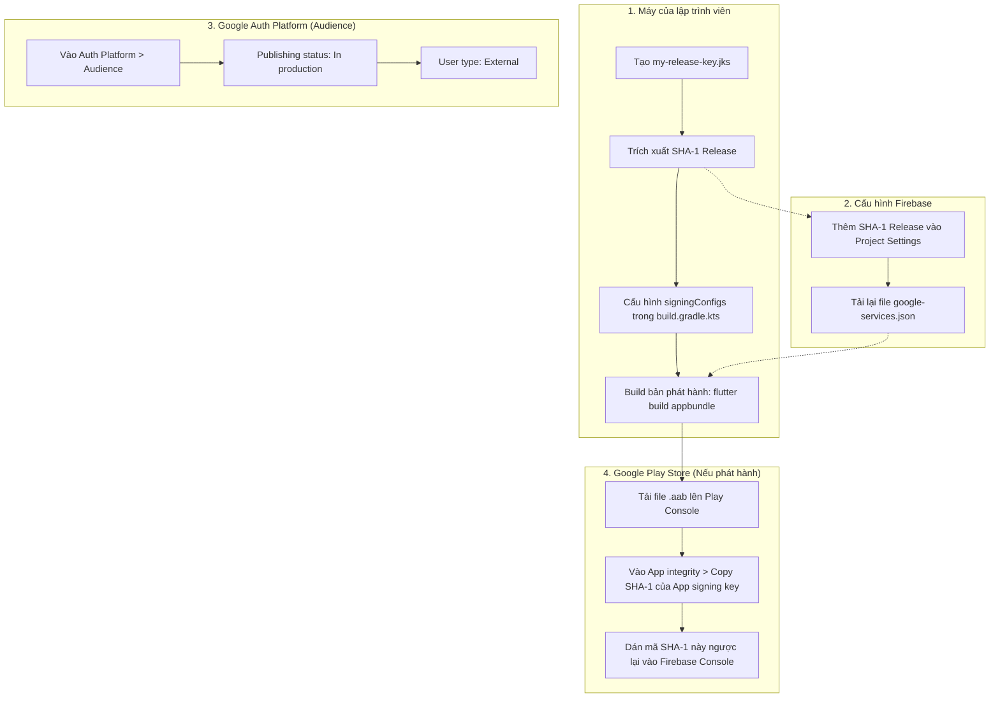

# Hướng Dẫn Cấu Hình Google Sign-In Trên Môi Trường Production (Bản Phát Hành Thực Tế)

Tài liệu này hướng dẫn chi tiết quy trình đưa tính năng **Google Sign-In & Firebase Authentication** lên môi trường **Production**, đảm bảo bất kỳ người dùng cuối nào (kể cả khi tải qua file Release APK hay từ Google Play Store) đều có thể đăng nhập thành công.

---

## 📌 Mục Lục
1. [Sự Khác Biệt Giữa Môi Trường Debug và Production](#1-sự-khác-biệt-giữa-môi-trường-debug-và-production)
2. [Bước 1: Tạo Release Keystore & Lấy Mã SHA-1 Release](#bước-1-tạo-release-keystore--lấy-mã-sha-1-release)
3. [Bước 2: Cấu Hình Chữ Ký Release Trong Gradle](#bước-2-cấu-hình-chữ-ký-release-trong-gradle)
4. [Bước 3: Chuyển Trạng Thái OAuth Sang "In production" (Google Auth Platform)](#bước-3-chuyển-trạng-thái-oauth-sang-in-production-google-auth-platform)
5. [Bước 4: Cấu Hình SHA-1 Từ Google Play App Signing (Khi Lên CH Play)](#bước-4-cấu-hình-sha-1-từ-google-play-app-signing-khi-lên-ch-play)
6. [Bước 5: Bảo Mật Thông Tin & Giới Hạn API Keys](#bước-5-bảo-mật-thông-tin--giới-hạn-api-keys)
7. [Quy Trình Tổng Quan Bằng Sơ Đồ](#quy-trình-tổng-quan-bằng-sơ-đồ)
8. [Checklist Trước Khi Xuất Xưởng (Go-Live Checklist)](#checklist-trước-khi-xuất-xưởng-go-live-checklist)

---

## 1. Sự Khác Biệt Giữa Môi Trường Debug và Production

| Tiêu chí | Môi Trường Debug (Phát triển) | Môi Trường Production (Phát hành) |
| :--- | :--- | :--- |
| **Lệnh chạy** | `flutter run` | `flutter run --release` hoặc cài file APK/AAB |
| **Khóa ký APK/AAB** | `debug.keystore` mặc định hoặc `shared-debug.keystore` | File khóa riêng `my-release-key.jks` được lưu trữ bảo mật |
| **Mã SHA-1** | Dành cho việc test nội bộ lập trình viên | Dùng cho tất cả người dùng hoặc do Google Play cấp |
| **Màn hình OAuth** | Chế độ **Testing** (Chỉ tối đa 100 email test được phép đăng nhập) | Chế độ **In production** (Bất kỳ ai có tài khoản Google đều đăng nhập được) |
| **Tối ưu mã nguồn** | Không obfuscate / không rút gọn code | Bật R8/Proguard minify và shrink resources |

---

## Bước 1: Tạo Release Keystore & Lấy Mã SHA-1 Release

Khi đóng gói bản phát hành (Release), bạn không được sử dụng `debug.keystore` mà phải tự tạo một **Keystore bảo mật**.

### 1.1. Tạo file Keystore phát hành:
Mở Terminal tại thư mục `android/app` và chạy lệnh:
```powershell
keytool -genkey -v -keystore my-release-key.jks -keyalg RSA -keysize 2048 -validity 10000 -alias my-key-alias
```

#### Các thông số được lấy từ đâu?
- **`keyAlias`**: Chính là tên bạn đặt sau tham số `-alias` (trong câu lệnh trên là `"my-key-alias"`).
- **`storePassword`**: Mật khẩu mà Terminal yêu cầu bạn nhập ở dòng:
  `Enter keystore password:` (Nhập tối thiểu 6 ký tự).
- **`keyPassword`**: Mật khẩu của alias khi Terminal hỏi:
  `Enter key password for <my-key-alias>:` (Nếu nhấn Enter thì mặc định nó trùng với `storePassword`).
*(Hãy ghi nhớ hoặc lưu các thông tin này vào nơi an toàn)*.

### 1.2. Lấy mã SHA-1 của Keystore Release:
Chạy lệnh sau tại thư mục `android/app`:
```powershell
keytool -list -v -keystore my-release-key.jks -alias my-key-alias
```
Nhập mật khẩu bạn vừa tạo, Terminal sẽ xuất ra thông tin chứng chỉ:
```text
Alias name: my-key-alias
Creation date: ...
Certificate fingerprint:
     MD5:  ...
     SHA1: 3F:7C:19:A8:D4:... (Copy chuỗi này)
     SHA256: ...
```

### 1.3. Cập nhật mã SHA-1 lên Firebase:
1. Đăng nhập [Firebase Console](https://console.firebase.google.com/) > Vào dự án của bạn (`prm323-lab3`).
2. Bấm vào biểu tượng **Project settings ⚙️** > Chọn tab **General**.
3. Cuộn xuống phần ứng dụng Android của bạn > Bấm **Add fingerprint**.
4. Dán mã **SHA-1 Release** vừa copy vào > Bấm **Save**.
5. Bấm **Download google-services.json** để tải file cấu hình mới nhất và ghi đè vào thư mục:
   ```text
   android/app/google-services.json
   ```

---

## Bước 2: Cấu Hình Chữ Ký Release Trong Gradle

Mở file `android/app/build.gradle.kts` và cấu hình ký chữ ký điện tử cho build release:

### 2.1. Cấu hình bảo mật qua file `key.properties` (Khuyên dùng)
> [!IMPORTANT]
> Tuyệt đối **không lưu trực tiếp mật khẩu Release Keystore vào `build.gradle.kts`** nếu bạn đẩy code lên GitHub công khai. Mặc định file `android/.gitignore` đã chặn file `key.properties` và `*.jks` để bảo vệ khóa của bạn.

1. Tạo file `android/key.properties` (Đã có trong `.gitignore`):
   ```properties
   storePassword=mat_khau_keystore_cua_ban
   keyPassword=mat_khau_alias_cua_ban
   keyAlias=my-key-alias
   storeFile=my-release-key.jks
   ```

2. Cập nhật file `android/app/build.gradle.kts`:
   ```kotlin
   import java.util.Properties
   import java.io.FileInputStream

   val keystorePropertiesFile = rootProject.file("key.properties")
   val keystoreProperties = Properties()
   if (keystorePropertiesFile.exists()) {
       keystoreProperties.load(FileInputStream(keystorePropertiesFile))
   }

   android {
       ...
       signingConfigs {
           create("release") {
               keyAlias = keystoreProperties["keyAlias"] as String
               keyPassword = keystoreProperties["keyPassword"] as String
               storeFile = file(keystoreProperties["storeFile"] as String)
               storePassword = keystoreProperties["storePassword"] as String
           }
       }

       buildTypes {
           release {
               signingConfig = signingConfigs.getByName("release")
               isMinifyEnabled = true
               isShrinkResources = true
               proguardFiles(
                   getDefaultProguardFile("proguard-android-optimize.txt"),
                   "proguard-rules.pro"
               )
           }
       }
   }
   ```

---

## Bước 3: Chuyển Trạng Thái OAuth Sang "In production" (Google Auth Platform)

> [!CAUTION]
> **Lỗi chặn truy cập 403 (Access blocked: This app is in testing)**:
> Khi chưa xuất bản (Publish), chỉ những email nằm trong danh sách **Test users** mới có thể đăng nhập. Người dùng thông thường khi bấm đăng nhập Google sẽ bị chặn ngay lập tức.

### Cách kiểm tra và chuyển trạng thái:
1. Mở đường link trực tiếp:
   👉 **[Google Cloud Auth Platform - Audience](https://console.cloud.google.com/auth/audience?project=prm323-lab3)**
   *(Thay `prm323-lab3` bằng Project ID của bạn nếu khác)*.
2. Kiểm tra mục **Publishing status**:
   - Nếu đang hiển thị **Testing**: Nhấn nút **PUBLISH APP** (Xuất bản ứng dụng) để chuyển sang **`In production`**.
   - Khi đã chuyển thành công, màn hình sẽ hiển thị:
     - **Publishing status:** `In production` (kèm nút *"Back to testing"*).
     - **User type:** `External`.
3. Hoàn thiện các thông tin hiển thị tại tab **Branding**:
   - **App name**: Tên ứng dụng khi người dùng thấy trên màn hình chọn tài khoản.
   - **User support email**: Email hỗ trợ khách hàng của bạn.
   - **Application privacy policy link**: Link đến trang Chính sách quyền riêng tư công khai.

---

## Bước 4: Cấu Hình SHA-1 Từ Google Play App Signing (Khi Lên CH Play)

> [!IMPORTANT]
> **Hiện tượng:** Khi tự build file Release APK cài thủ công thì đăng nhập Google thành công, nhưng khi người dùng tải ứng dụng từ **Google Play Store** về máy thì lại bị lỗi đăng nhập!
> 
> **Nguyên nhân:** Google Play Store sử dụng cơ chế **Play App Signing**. File `my-release-key.jks` trên máy bạn chỉ đóng vai trò là **Upload Key**. Khi tải file lên, Google sẽ bóc tách và tự ký lại ứng dụng bằng một chứng chỉ riêng của Google mang tên **App Signing Key**.

### Cách xử lý:
1. Đăng nhập [Google Play Console](https://play.google.com/console).
2. Chọn ứng dụng phát hành của bạn.
3. Ở menu thanh bên, chọn **Release** > **Setup** > **App integrity**.
4. Chọn tab **App signing**.
5. Tìm khối **App signing key certificate**, copy dòng **SHA-1 certificate fingerprint**.
6. Quay lại **Firebase Console** > **Project Settings** > Nhấn **Add fingerprint** và dán mã SHA-1 này vào.
*(Không cần xóa mã SHA-1 của upload key cũ; Firebase hỗ trợ nhiều mã SHA-1 cùng lúc)*.

---

## Bước 5: Bảo Mật Thông Tin & Giới Hạn API Keys

Để bảo vệ hạn mức và tránh bị kẻ xấu lạm dụng API Key của dự án:
1. Truy cập [Google Cloud Console - Credentials](https://console.cloud.google.com/apis/credentials?project=prm323-lab3).
2. Tìm khóa API đại diện cho Android (được sinh tự động bởi Firebase).
3. Đặt **Application restrictions** thành **Android apps**.
4. Thêm đúng **Package name** (`com.example.prm393_lab03_se192947`) và các mã **SHA-1** hợp lệ.
5. Đặt **API restrictions** chỉ cho phép các API cần thiết:
   - *Firebase Authentication API*
   - *Token Service API*
   - *Google Identity Toolkit API*

---

## Quy Trình Tổng Quan Bằng Sơ Đồ



---

## Checklist Trước Khi Xuất Xưởng (Go-Live Checklist)

- [ ] Đã tạo file khóa `my-release-key.jks` và sao lưu cẩn thận ở nơi an toàn.
- [ ] File `key.properties` và file `my-release-key.jks` đã được thêm vào `.gitignore`.
- [ ] Đã thêm mã SHA-1 của Release Keystore vào Firebase Console.
- [ ] Đã cập nhật file `google-services.json` mới nhất vào thư mục `android/app/`.
- [ ] Đã xác nhận mục **Audience** hiển thị **`Publishing status: In production`** và **`User type: External`** trên Google Cloud Console.
- [ ] Đã cung cấp đường dẫn Chính sách quyền riêng tư (Privacy Policy URL).
- [ ] (Nếu đưa lên CH Play): Đã copy mã SHA-1 của **Google Play App Signing** và thêm vào Firebase Console.
- [ ] Đã kiểm tra build thử nghiệm trên thiết bị thật:
  ```powershell
  flutter build apk --release
  flutter install --release
  ```
