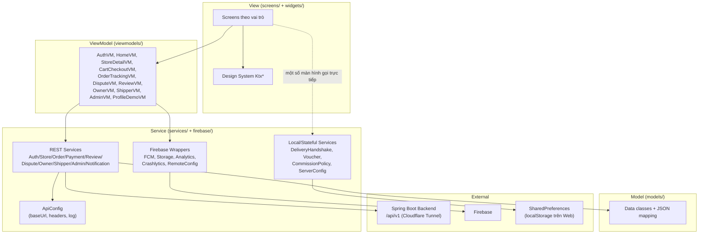
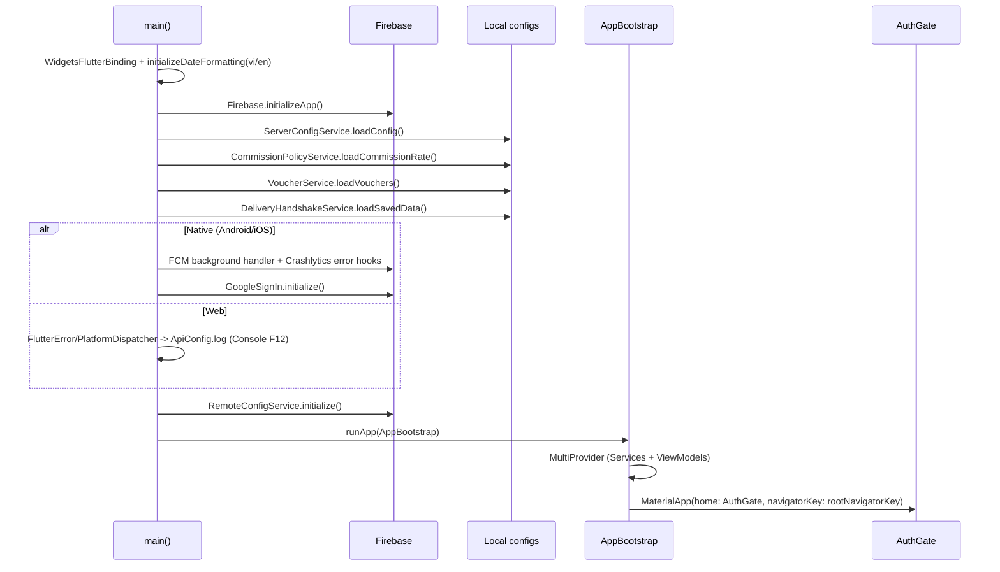
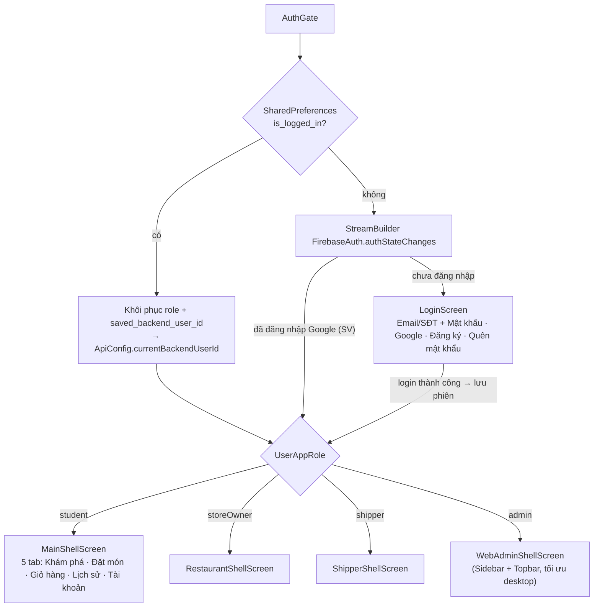
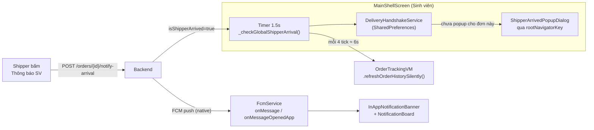
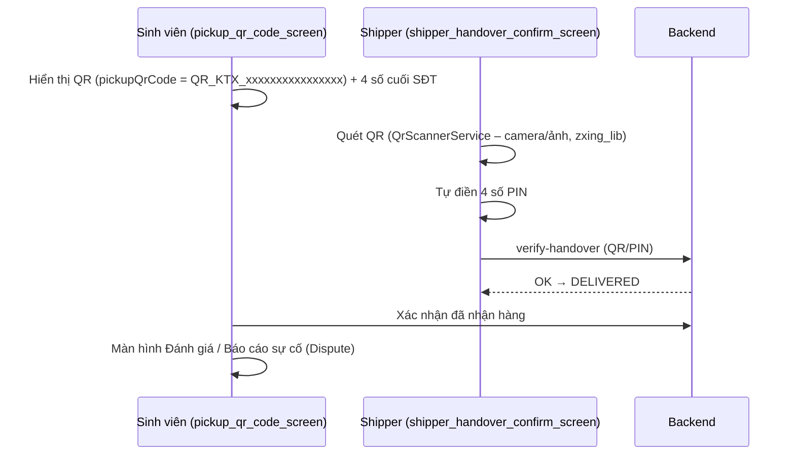
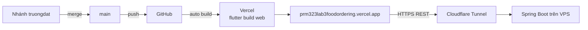

# Kiến trúc Frontend – KTX Food Ordering (Flutter)

> Tài liệu mô tả kiến trúc thực tế của mã nguồn trong `lib/` (cập nhật 11/2026).
> Xem thêm: [architecture.md](./architecture.md) (tổng quan Lab 3), [design-traceability.md](./design-traceability.md).

---

## 1. Tổng quan

| Hạng mục | Giá trị |
|---|---|
| Framework | Flutter (Dart SDK `^3.13`), Material 3 |
| Nền tảng chạy | **Web** (deploy Vercel), Android, iOS |
| Kiến trúc | **MVVM + Provider** (Model – Service – ViewModel – View) |
| Quản lý state | `provider` (`ChangeNotifier`) + sealed class `ScreenState<T>` |
| Giao tiếp Backend | REST JSON qua `package:http` → Spring Boot (`/api/v1`) qua Cloudflare Tunnel |
| Dịch vụ Cloud | Firebase Auth, Storage, Messaging (FCM), Analytics, Crashlytics, Remote Config |
| Lưu trữ cục bộ | `shared_preferences` (phiên đăng nhập, cấu hình, trạng thái bàn giao) |
| Tiện ích khác | `qr_flutter` (sinh QR), `zxing_lib` (giải mã QR thuần Dart), `image_picker`, `intl`, `crypto` |
| Production URL | https://prm323lab3foodordering.vercel.app |

Ứng dụng phục vụ **4 vai trò** trong cùng một codebase: **Sinh viên**, **Chủ quán**, **Shipper**, **Admin BQL** (giao diện web).

---

## 2. Cấu trúc thư mục

```text
lib/
├── main.dart                 # Entry point: bootstrap, MultiProvider (DI), AuthGate, LoginScreen, MainShellScreen (SV)
├── firebase_options.dart     # Cấu hình Firebase sinh bởi FlutterFire CLI
├── models/       (18 file)   # Data class + fromJson/toJson: Order, Store, MenuItem, User, Dispute, Voucher, ShipperBatch…
├── services/     (22 file)   # Gọi REST API, nghiệp vụ cục bộ, cấu hình endpoint (ApiConfig)
├── firebase/     (5 file)    # Wrapper Firebase SDK: Analytics, Storage, FCM, Remote Config
├── viewmodels/   (11 file)   # ChangeNotifier giữ state màn hình, điều phối Service
├── screens/      (52 file)   # Màn hình (View) – chia theo vai trò qua tiền tố tên file
├── widgets/      (25 file)   # Design System components (Ktx*) + widget dùng chung (popup, sidebar admin…)
└── theme/        (5 file)    # Design tokens: AppColors, AppTypography, AppSpacing, AppRadius
```

Quy ước đặt tên màn hình theo vai trò:

| Tiền tố | Vai trò | Ví dụ |
|---|---|---|
| *(không tiền tố)* | Sinh viên | `home_screen`, `store_detail_screen`, `cart_screen`, `order_history_screen`, `pickup_qr_code_screen` |
| `restaurant_*` | Chủ quán | `restaurant_dashboard_screen`, `restaurant_menu_management_screen`, `restaurant_revenue_screen` |
| `shipper_*` | Shipper | `shipper_batch_pickup_screen`, `shipper_handover_confirm_screen`, `shipper_wallet_screen` |
| `web_admin_*` | Admin BQL (Web) | `web_admin_dashboard_screen`, `web_admin_orders_screen`, `web_admin_users_screen` |

---

## 3. Sơ đồ phân lớp

Chiều phụ thuộc **chỉ đi từ trên xuống**: View → ViewModel → Service → Model/External.



> [!NOTE]
> Một số màn hình phức tạp (ví dụ `shipper_handover_confirm_screen`, `pickup_qr_code_screen`) đọc trực tiếp các service có state như `DeliveryHandshakeService` qua `context.read/watch`, thay vì đi qua một ViewModel riêng.

---

## 4. Khởi động ứng dụng (Bootstrap)

Luồng trong [`main()`](../lib/main.dart):



### Dependency Injection
`AppBootstrap` đăng ký toàn bộ dependency qua `MultiProvider`:

- **`Provider<T>`** (stateless): `AuthApiService`, `StoreService`, `OrderService`, `PaymentService`, `ReviewService`, `NotificationService`, `DisputeService`, `OwnerApiService`, `ShipperApiService`, `AdminApiService`, `CloudStorageService`, `AnalyticsService`, `CrashlyticsService`, `FcmService`.
- **`ChangeNotifierProvider.value`** (singleton có state): `RemoteConfigService`, `VoucherService`, `DeliveryHandshakeService`.
- **`ChangeNotifierProvider`** cho 11 ViewModel, mỗi ViewModel nhận Service qua constructor (`ctx.read<XService>()`), nên test có thể inject mock dễ dàng.

`rootNavigatorKey` (global `NavigatorState`) cho phép hiển thị popup (ví dụ "Shipper đã tới cổng") **từ bất kỳ màn hình nào**.

---

## 5. Xác thực & Điều hướng theo vai trò



- **Phiên đăng nhập** lưu bằng `shared_preferences` (`is_logged_in`, `saved_user_role`, `saved_backend_user_id`). Trên Web là `localStorage`, nên F5 không mất phiên.
- **Định danh với Backend:** mọi request gửi header `X-User-Id: <currentBackendUserId>` (xem [`ApiConfig.headers`](../lib/services/api_config.dart)). Có thể kèm `Authorization: Bearer <Firebase idToken>` khi có.
- **Quên mật khẩu:** [`forgot_password_screen`](../lib/screens/forgot_password_screen.dart) gọi `POST /auth/forgot-password/send-otp`, Backend sinh OTP 6 số (in ra terminal VPS), rồi `POST /auth/forgot-password/reset`. Không dùng Firebase Phone Auth.
- **Đăng xuất:** xóa key phiên, reset `currentBackendUserId`, sign-out Google/Firebase.

---

## 6. Quản lý State

### 6.1 `ScreenState<T>` – sealed class chuẩn cho mọi màn hình tải dữ liệu
Định nghĩa tại [`screen_state.dart`](../lib/widgets/screen_state.dart):

```dart
sealed class ScreenState<T> {}
StateInitial<T> | StateLoading<T> | StateEmpty<T> | StateSuccess<T>(data) | StateError<T>(msg, canRetry)
```

View dùng `switch` theo pattern để hiển thị `KtxLoadingState` / `KtxEmptyState` / `KtxErrorState` (có nút Thử lại) / nội dung thật.

### 6.2 Mẫu ViewModel
```dart
class HomeViewModel extends ChangeNotifier {
  final StoreService _storeService;            // inject qua constructor
  ScreenState<List<StoreModel>> _storesState = const StateLoading();

  Future<void> loadHomeData() async {
    _storesState = const StateLoading(); notifyListeners();
    try {
      final stores = await _storeService.fetchStores(...);
      _storesState = stores.isEmpty ? StateEmpty(...) : StateSuccess(stores);
    } catch (e) {
      _storesState = StateError('...');
    }
    notifyListeners();
  }
}
```

### 6.3 Bảng ViewModel

| ViewModel | Phạm vi | Service phụ thuộc |
|---|---|---|
| `AuthViewModel` | Đăng nhập, đồng bộ user, hồ sơ, avatar | `AuthApiService` |
| `HomeViewModel` | Danh sách quán, tìm kiếm, khu KTX, badge thông báo | `StoreService`, `NotificationService` |
| `StoreDetailViewModel` | Chi tiết quán, menu, đánh giá | `StoreService`, `ReviewService` |
| `CartCheckoutViewModel` | Giỏ hàng gom đơn, voucher, tạo đơn, thanh toán | `OrderService`, `PaymentService` |
| `OrderTrackingViewModel` | Lịch sử & theo dõi đơn, refresh ngầm | `OrderService` |
| `DisputeViewModel` | Khiếu nại/hoàn tiền, upload bằng chứng | `DisputeService`, `CloudStorageService` |
| `ReviewViewModel` | Đánh giá món/quán | `ReviewService` |
| `ProfileDemoViewModel` | Hộp thư thông báo in-app, metadata FCM, test Crashlytics | `NotificationService`, `CrashlyticsService` |
| `OwnerViewModel` | Đơn của quán, doanh thu | `OwnerApiService` |
| `ShipperViewModel` | Ca giao, batch đơn, ví | `ShipperApiService` |
| `AdminViewModel` | Dashboard BQL | `AdminApiService` |

---

## 7. Tầng Networking

- **[`ApiConfig`](../lib/services/api_config.dart)**: nơi duy nhất chứa `baseUrl`. Thứ tự ưu tiên: `--dart-define=API_URL` → `--dart-define=API_BASE_URL` → `activeCloudflareUrl`. Tự loại bỏ các URL tunnel cũ đã chết.
- **Service pattern:** mỗi service nhận `http.Client` qua constructor (mặc định `http.Client()`), nên test được bằng `MockClient`.
- **Timeout** cho từng request (6–18s tùy loại). Ví dụ `OrderService.fetchMyOrders` dùng 18s, các thao tác cập nhật trạng thái dùng 6s.
- **Fallback cache:** `OrderService` giữ cache đơn trong bộ nhớ. Khi API lỗi hoặc timeout thì trả cache thay vì làm trắng màn hình.
- **Response chuẩn:** Backend trả `{ success, message, data, timestamp }`, được map qua [`ApiResponse`](../lib/models/api_response.dart).
- **Logging:** `ApiConfig.log(tag, msg)` in `[HH:mm:ss][TAG]` ra Console (kể cả bản release trên Vercel). Các tag chính: `DB-ORDER`, `DB-STORE`, `DB-MENU`, `SESSION-*`, `AUTH-OTP`, `KTX-BOOT`.

---

## 8. Realtime & Thông báo

App dùng **kết hợp 3 cơ chế**:



1. **Polling toàn cục:** `MainShellScreen` chạy `Timer.periodic(1.5s)`, chỉ xét các đơn **chưa DELIVERED/CANCELLED** và chỉ popup đúng đơn có `isShipperArrived`. Cờ `hasPoppedDialog` tránh popup lặp. Mỗi 4 tick mới gọi API refresh để không nghẽn mạng.
2. **FCM:** native nhận push foreground/background. Bấm thông báo sẽ mở đúng màn hình (`NotificationBoardScreen.navigateByNotificationType`).
3. **`DeliveryHandshakeService`** (singleton `ChangeNotifier`): lưu trạng thái bàn giao 2 chiều (SV xác nhận / Shipper xác nhận / đã popup) vào `SharedPreferences`, đồng bộ giữa các màn hình.

### Luồng bàn giao đơn (Handshake)


---

## 9. Tích hợp Firebase

| Dịch vụ | File | Mục đích | Web |
|---|---|---|---|
| Auth | `main.dart`, `auth_vm.dart` | Google Sign-In (Sinh viên) | ✅ (popup) |
| Storage | `firebase/cloud_storage_service.dart`, `evidence_upload_service.dart` | Avatar, ảnh bằng chứng khiếu nại | ✅ |
| Messaging | `firebase/fcm_service.dart` | Push thông báo đơn hàng | ⚠️ hạn chế |
| Analytics | `firebase/analytics_service.dart` | Event `view_store_detail`, `add_to_cart`, `purchase`… | ✅ |
| Crashlytics | `services/crashlytics_service.dart` | Fatal error, user context | ❌ (Web log ra Console) |
| Remote Config | `firebase/remote_config_service.dart` | Feature flag / cấu hình động | ✅ |

---

## 10. Design System

- **Tokens** trong `theme/`: `AppColors` (primary cam `#FF5722`), `AppTypography` (heading1–3, body…), `AppSpacing`, `AppRadius`, gom lại trong `ktx_design_system.dart`.
- **Components** `widgets/ktx_*`: `KtxButton`, `KtxTextField`, `KtxCard`, `KtxPill`, `KtxDialog`, `KtxAppBar`, `KtxBottomNavBar`, `KtxFoodItemCard`, `KtxStickyCartBar`, `KtxLoadingState`, `KtxEmptyState`, `KtxErrorState`.
- **Responsive:** `LoginScreen` dùng breakpoint `width >= 880` cho layout desktop 2 cột. Admin dùng `WebAdminSidebar` + `WebAdminTopbar`. SV/Chủ quán/Shipper tối ưu cho viewport mobile.
- **Accessibility/Test:** nhiều widget bọc `Semantics(identifier: ...)` phục vụ automation test.

---

## 11. Build & Deploy



- [`vercel.json`](../vercel.json): rewrite mọi route về `/index.html` (SPA). Header `Cross-Origin-Opener-Policy: same-origin-allow-popups` để Google Sign-In popup chạy được.
- Đổi backend lúc build: `flutter build web --dart-define=API_URL=https://<tunnel>/api/v1`.
- Chạy local: `flutter run -d chrome --web-port=5050`.

---

## 12. Kiểm thử

Thư mục `test/` (47 test, `flutter test`):

| File | Nội dung |
|---|---|
| `auth_role_flow_test` | Enum vai trò, chuyển role |
| `avatar_management_test` | `AuthApiService` (MockClient), `AuthViewModel`, widget `KtxAppBar` |
| `cart_and_review_vm_test` | Logic giỏ hàng / đánh giá |
| `dispute_model_test`, `dispute_vm_validation_test` | Model & validate khiếu nại |
| `voucher_service_test`, `commission_policy_service_test` | Nghiệp vụ voucher, hoa hồng |
| `server_config_test`, `crashlytics_service_test`, `admin_web_test` | Cấu hình, Crashlytics, model Admin |
| `widget_test` | Smoke test Design System |

---

## 13. Hạn chế đã biết / Nợ kỹ thuật

> [!WARNING]
> Các điểm dưới đây chấp nhận được ở mức đồ án nhưng cần xử lý nếu đưa vào production.

- **Xác thực Backend yếu:** định danh chỉ bằng header `X-User-Id`, chưa có JWT/session server-side.
- **ID cứng trong `AuthGate`:** Chủ quán `ownerId: '1'`, Shipper `shipperId: '3'`.
- **OTP demo `123456`** vẫn được chấp nhận ở cả FE lẫn BE.
- **`main.dart` quá lớn (~1400 dòng)**, chứa AuthGate, LoginScreen và MainShellScreen. Nên tách ra `screens/`.
- **Nhiều màn hình > 1000 dòng** (`group_cart_checkout_screen`, `shipper_batch_pickup_screen`, `home_screen`…). Nên tách widget con.
- **Polling 1.5s** thay cho WebSocket/SSE. Đã giảm tải bằng cách chỉ refresh API mỗi ~6s, nhưng vẫn tốn tài nguyên khi mở lâu.
- **Singleton service có state** (`DeliveryHandshakeService`, `VoucherService`) dùng chung `SharedPreferences`, nên state bàn giao chỉ đồng bộ trên **cùng thiết bị/trình duyệt**. Giữa các thiết bị phải dựa vào dữ liệu Backend.
- **Còn code dư thừa** sau khi bỏ cấu hình server trên UI: `role_selection_sheet.dart` và `phone_auth_service.dart` (Firebase Phone) không còn được import ở đâu. `server_config_dialog.dart` vẫn được import trong `main.dart`, nhưng hàm `_openServerConfigDialog()` không còn nút nào gọi.
