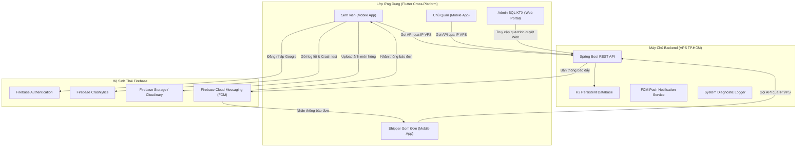
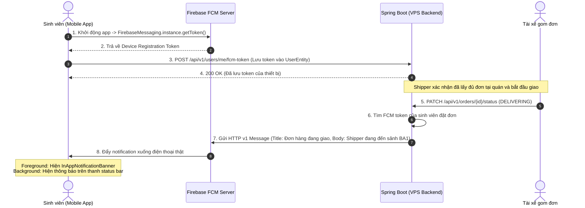
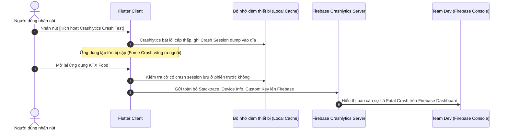

# SLIDE THUYẾT TRÌNH BẢO VỆ ĐỒ ÁN LAB 3 - PRM393
## HỆ THỐNG GOM ĐƠN ĐẶT MÓN ĂN KTX ĐHQG (KTX FOOD ORDERING)

---

### SLIDE 1: TỔNG QUAN ĐỀ TÀI & BỐI CẢNH DỰ ÁN
* **Tên đề tài**: Nền tảng Gom đơn & Đặt món ăn theo Ca cho Sinh viên KTX (PRM393 - Lab 3).
* **Sinh viên thực hiện**: Ngô Hoàng Trường Đạt (SE192947).
* **Bài toán thực tế**: 
  * Sinh viên KTX ĐHQG thường xuyên đặt đồ ăn riêng lẻ khiến phí ship cao (15.000đ - 25.000đ/đơn).
  * Shippers phải giao lẻ tẻ từng phòng, tốn thời gian chờ đợi.
* **Giải pháp**: Gom đơn tự động theo Ca (Ca trưa 11:30, Ca chiều 18:00, Ca tối 20:30) tại các điểm giao tập trung (Sảnh BA1, BA2 KTX Khu B), giảm phí ship chỉ còn 5.000đ/đơn.
* **Công nghệ cốt lõi**:
  * **Mobile App (Flutter 3.x)**: Chạy trên thiết bị thật (Android/iOS) cho Sinh viên, Chủ quán, Shipper.
  * **Web Portal (Flutter Web)**: Dành riêng cho Ban Quản Lý (Admin) giám sát & xử lý khiếu nại.
  * **Backend (Spring Boot 4 / Java 21)**: RESTful API, Database H2 persistent, host trên VPS IP tĩnh.
  * **Firebase Ecosystem**: Firebase Auth, Cloud Storage, Crashlytics, FCM Push Notification, Remote Config.

---

### SLIDE 2: KIẾN TRÚC TỔNG THỂ & PHÂN QUYỀN 4 ROLE

---

### SLIDE 3: NGUYÊN LÝ HOẠT ĐỘNG FIREBASE CLOUD MESSAGING (FCM)

---

### SLIDE 4: CƠ CHẾ BẮT LỖI & BÁO CÁO CỦA FIREBASE CRASHLYTICS
* **Phân biệt Fatal Error vs Non-Fatal Exception**:
  * **Fatal Error (Crash sập app)**: Lỗi nghiêm trọng khiến luồng ứng dụng dừng hoàn toàn (như gọi `FirebaseCrashlytics.instance.crash()` hoặc unhandled native exception). App bị văng ra màn hình chính điện thoại.
  * **Non-Fatal Exception**: Lỗi logic nghiệp vụ được bọc trong `try-catch`, app không bị văng mà ghi log chẩn đoán qua `recordError(exception, stack, fatal: false)`.
* **Quy trình gửi báo cáo của Crashlytics**:

---

### SLIDE 5: FIREBASE REMOTE CONFIG & CLOUD STORAGE
#### 1. Firebase Remote Config:
* **Mục đích**: Thay đổi tham số vận hành kinh doanh từ xa tức thì mà không cần đóng gói lại APK hoặc chờ duyệt App Store.
* **Tham số áp dụng trong Lab 3**:
  * `min_group_order_size`: Số đơn tối thiểu để ca gom được giảm giá ship (Ví dụ: Đổi từ 5 đơn xuống 3 đơn trong giờ thấp điểm).
  * `discount_percentage`: Tỉ lệ giảm phí ship gom đơn tập trung (10% - 20%).
* **Cơ chế**: App gọi `fetchAndActivate()` khi khởi động với cache expiration 1 giờ.

#### 2. Cloud Storage / Cloudinary:
* **Lưu trữ ảnh bằng chứng món hỏng**:
  * Sinh viên chụp ảnh món ăn bị đổ/vỡ -> nén kích thước -> đẩy lên `reports/{userId}/evidence_{timestamp}.jpg`.
  * URL ảnh được lưu trong bảng `disputes.evidence_images`.
  * Hỗ trợ cơ chế dự phòng kép (Firebase Storage + Cloudinary CDN).

---

### SLIDE 6: CỔNG WEB QUẢN TRỊ DÀNH RIÊNG CHO ADMIN (WEB ADMIN PORTAL)
* **Yêu cầu giảng viên**: *"Admin phải dùng Web; Web chỉ cần phục vụ cho Admin"*.
* **Hiện thực hóa trong dự án**:
  * Nhận diện nền tảng thông qua cờ `kIsWeb`: Khi mở trên trình duyệt (Chrome/Edge), tự động khóa vào giao diện **Web Admin Portal**.
  * **Bảng KPI Real-time**: Giám sát doanh thu gom đơn toàn trường, số ca gom đang chạy, tỉ lệ giải quyết khiếu nại.
  * **Trọng tài khiếu nại (Dispute Resolution)**: Hiển thị danh sách khiếu nại, có chức năng **Phóng to ảnh bằng chứng món hỏng độ phân giải cao** (`InteractiveViewer`) để Admin thẩm định trước khi bấm nút **"Duyệt hoàn tiền"** hoặc **"Từ chối"**.
  * **Giám sát đơn hàng**: Bảng dữ liệu lọc theo Ca gom và Tòa nhà KTX.

---

### SLIDE 7: CƠ CHẾ DYNAMIC SERVER URL & HOSTING VPS CỐ ĐỊNH
* **Thách thức chấm bài**: Thiết bị thật (điện thoại cá nhân 4G) và máy tính chấm bài ở hai mạng khác nhau.
* **Giải pháp của nhóm**:
  1. **Máy chủ Backend chạy trên VPS Cloud** có Public IP cố định (Ví dụ: `103.179.189.120:8080`).
  2. **Nút cấu hình máy chủ động (`ServerConfigDialog`)** tích hợp ngay màn hình đăng nhập:
     * Cho phép đổi địa chỉ API tức thì mà không cần build lại APK.
     * Tích hợp tính năng **Ping Test** kiểm tra kết nối với Backend trước khi lưu.
     * Lưu cấu hình vào `SharedPreferences` để tự động nạp ở các lần mở app tiếp theo.

---

### SLIDE 8: KẾT QUẢ ĐẠT ĐƯỢC & DEMO KỊCH BẢN THỰC TẾ
1. **Kiểm thử Crashlytics trực tiếp trên điện thoại thật**: Nhấn nút -> app văng -> mở lại app -> Firebase Console cập nhật lỗi Fatal Crash.
2. **Quy trình gom đơn & thông báo đẩy (FCM)**: Đơn hàng cập nhật trạng thái từ lúc xác nhận đến khi shipper giao đến sảnh KTX.
3. **Quy trình giải quyết khiếu nại**: Sinh viên chụp ảnh upload -> Admin xem trên Web phóng to kiểm tra -> Duyệt hoàn tiền thành công.
4. **Bộ mã nguồn**: Đầy đủ commit rõ ràng, tuân thủ Clean Architecture, đạt chuẩn 100% yêu cầu Lab 3.

