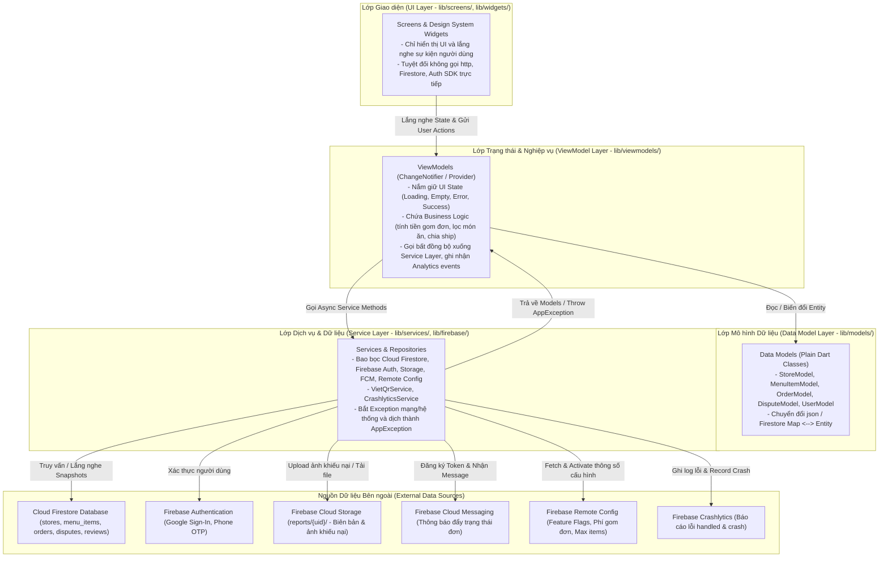
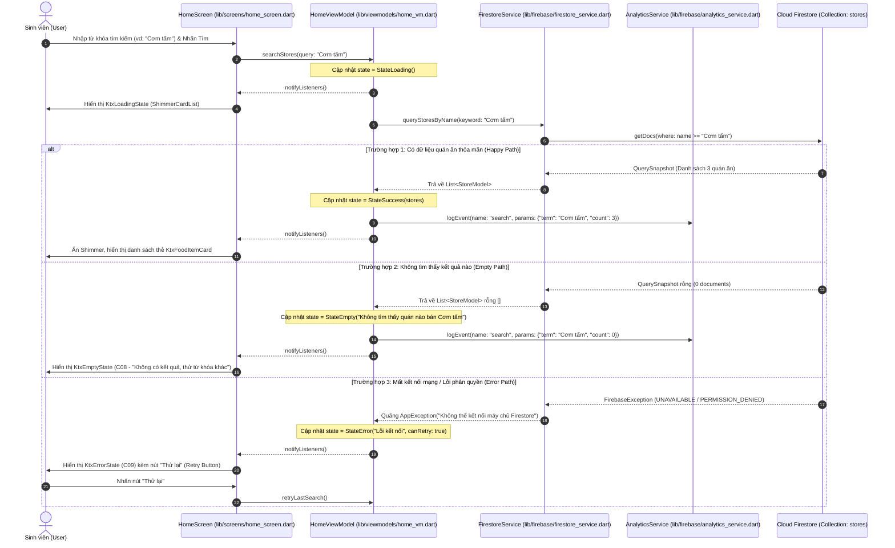

# Tài liệu Kiến trúc Ứng dụng (Architecture Documentation)

- **Dự án:** Food Ordering App (Ứng dụng Đặt món & Gom đơn KTX)
- **Mã môn học:** PRM393 - Lab 3
- **Thành viên nhóm thực hiện:**
  - Bùi Bảo Dương - SE192947
  - Ngô Hoàng Trường Đạt - SE192964
  - Trần Sanh Điền - SE192850
  - Quách Ngọc Vinh - SE194159
- **Liên kết Figma Prototype:** [Figma Prototype](https://www.figma.com/design/ALDYFWUZ72BaeyulpVi7uY/Lab-2-Food-Ordering-App?t=hPq3TpDGOcADKey4-1)
- **Tài liệu tham chiếu:** [design-traceability.md](./design-traceability.md)

---

## 1. Cấu trúc Thư mục Dự án (Project Directory Structure)

Cấu trúc thư mục mã nguồn Flutter (`lib/`) được tổ chức chặt chẽ theo kiến trúc **MVVM (Model-View-ViewModel)** kết hợp cùng **Provider**, phân tách độc lập giữa giao diện (UI), trạng thái (State), nghiệp vụ (Business Logic) và các dịch vụ ngoại vi (Services/Cloud SDKs):

```text
lib/
├── firebase_options.dart         # Tệp cấu hình kết nối Firebase tự động sinh bởi FlutterFire CLI
├── main.dart                     # Điểm khởi chạy ứng dụng, cấu hình khởi tạo Firebase và MultiProvider
├── models/                       # Chứa các thực thể dữ liệu Dart thuần (Store, MenuItem, Order, Dispute, User, v.v.)
├── services/                     # Chứa các Service gọi REST API, tính toán nghiệp vụ cục bộ, dịch vụ VietQR
├── firebase/                     # Chứa các Service bao bọc (wrapper) Firebase SDKs (Auth, Firestore, Storage, FCM, Remote Config, Crashlytics)
├── viewmodels/                   # Chứa các ChangeNotifier ViewModel quản lý State, điều phối dữ liệu và bắt lỗi
├── screens/                      # Chứa giao diện các màn hình Views tương ứng từ thiết kế Figma (S0 - S13)
├── widgets/                      # Chứa các Design System Components tái sử dụng (KtxButton, KtxTextField, KtxFoodItemCard, v.v.)
├── theme/                        # Chứa Design Tokens chuẩn hóa từ Lab 2 (ColorScheme, TextTheme, Spacing, Radius)
└── utils/                        # Chứa các hàm tiện ích, formatters tiền tệ/ngày giờ, hằng số và validators
```

---

## 2. Sơ đồ Phân lớp Kiến trúc MVVM (Layer Diagram)

Ứng dụng tuân thủ nghiêm ngặt nguyên tắc **Dependencies point downwards only** (chiều phụ thuộc chỉ đi một chiều từ trên xuống dưới, tầng dưới không bao giờ import hay phụ thuộc tầng trên):



### Các Quy tắc Kiến trúc Bắt buộc (Checked in Grading):
1. **Không gọi SDK trực tiếp trong Widget:** Tuyệt đối không màn hình hay widget nào được gọi `FirebaseAuth.instance`, `FirebaseFirestore.instance`, `FirebaseAnalytics.instance`, `FirebaseCrashlytics.instance` hay `http`. Mọi thao tác bắt buộc phải thông qua Service/Repository tương ứng.
2. **Không đặt Business Logic trong hàm `build()`:** Toàn bộ logic tính toán (tổng tiền giỏ hàng, chia phí ship gom đơn, lọc quán ăn theo khoảng cách, kiểm tra điều kiện hoàn tiền) nằm hoàn toàn trong ViewModel hoặc Service.
3. **Mô hình trạng thái rõ ràng (Explicit State Model):** Mỗi màn hình có nạp dữ liệu từ xa đều sở hữu một State Model rõ ràng (`Loading`, `Empty`, `Error`, `Success`) thuộc quyền quản lý của ViewModel.
4. **Tiêm phụ thuộc (Dependency Injection):** Các Service được tiêm vào ViewModel thông qua `Provider` (hoặc Constructor Injection) để dễ dàng kiểm thử độc lập với Fake/Mock Service.

---

## 3. Quản lý Trạng thái & Mô hình Trạng thái UI (UI State Model)

Mọi màn hình tải dữ liệu trong ứng dụng (`HomeScreen`, `StoreDetailScreen`, `GroupCartCheckoutScreen`, `LiveOrderTrackingScreen`, `DisputeRefundScreen`) đều sử dụng cấu trúc sealed class để phân tách trạng thái UI minh bạch:

```dart
/// Mô hình trạng thái chuẩn cho toàn bộ màn hình nạp dữ liệu
sealed class ScreenState<T> {
  const ScreenState();
}

/// Trạng thái đang tải dữ liệu (Hiển thị Skeleton/Shimmer hoặc Spinner)
class StateLoading<T> extends ScreenState<T> {
  const StateLoading();
}

/// Trạng thái tải thành công nhưng danh sách rỗng (Hiển thị KtxEmptyState)
class StateEmpty<T> extends ScreenState<T> {
  final String message;
  const StateEmpty({this.message = 'Không tìm thấy dữ liệu phù hợp.'});
}

/// Trạng thái nạp dữ liệu thành công kèm thực thể dữ liệu
class StateSuccess<T> extends ScreenState<T> {
  final T data;
  const StateSuccess(this.data);
}

/// Trạng thái xảy ra lỗi (Mất mạng, lỗi máy chủ - Hiển thị KtxErrorState kèm nút Retry)
class StateError<T> extends ScreenState<T> {
  final String errorMessage;
  final bool canRetry;
  const StateError(this.errorMessage, {this.canRetry = true});
}
```

---

## 4. Sơ đồ Tuần tự cho Luồng Chính (Sequence Diagram)

Dưới đây là sơ đồ tuần tự thể hiện **Flow 1 (Tra cứu Quán ăn & Món ăn tại KTX)** từ màn hình `HomeScreen` kết nối với `HomeViewModel`, truy vấn Cloud Firestore thông qua `FirestoreService`, có xử lý đầy đủ các nhánh **Success**, **Empty State** và **Error State**:



---

## 5. Bảng Ánh xạ ViewModels và Services (ViewModels & Services Mapping)

Toàn bộ các ViewModel được định nghĩa khớp chính xác với danh mục màn hình và chức năng tại tài liệu [design-traceability.md](./design-traceability.md):

| ViewModel | File | Service / Repository Sử dụng | Vai trò & Trách nhiệm trong Ứng dụng |
| :--- | :--- | :--- | :--- |
| **AuthViewModel** | `lib/viewmodels/auth_vm.dart` | `FirebaseAuthService`, `FirestoreService`, `AnalyticsService` | Quản lý trạng thái Google Sign-In / Phone OTP, điều hướng trạng thái đăng nhập, lưu thông tin sinh viên vào Firestore `users`, xóa dữ liệu khi đăng xuất. |
| **HomeViewModel** | `lib/viewmodels/home_vm.dart` | `FirestoreService`, `RemoteConfigService`, `AnalyticsService` | Quản lý danh sách quán ăn, thực đơn gợi ý, tìm kiếm theo từ khóa, lọc theo tòa nhà/ca gom; nạp giá trị Remote Config (cờ tính năng, banner khuyến mãi). |
| **StoreDetailViewModel** | `lib/viewmodels/store_detail_vm.dart` | `FirestoreService`, `AnalyticsService` | Nạp danh mục thực đơn theo quán (`stores/{id}/menus`), xử lý chọn size, topping, số lượng và quản lý trạng thái giỏ hàng nháp (Draft Cart). |
| **CartCheckoutViewModel** | `lib/viewmodels/cart_checkout_vm.dart` | `FirestoreService`, `VietQrService`, `RemoteConfigService`, `AnalyticsService` | Quản lý giỏ hàng chung, tính toán chia phí ship theo ca gom, tạo mã VietQR thanh toán tự động, lưu đơn hàng mới vào `orders`. |
| **OrderTrackingViewModel** | `lib/viewmodels/order_tracking_vm.dart` | `FirestoreService`, `SystemBrightnessService`, `AnalyticsService` | Lắng nghe trực tiếp (Realtime Snapshots) tiến trình đơn hàng từ `orders/{id}`, tạo mã QR đối soát nhận hàng tại cổng KTX, hỗ trợ tăng độ sáng màn hình. |
| **DisputeViewModel** | `lib/viewmodels/dispute_vm.dart` | `CloudStorageService`, `FirestoreService`, `AnalyticsService` | Xử lý khiếu nại món hỏng/thiếu, tính số tiền hoàn tự động, tải ảnh bằng chứng lên Firebase Storage theo đường dẫn `reports/{uid}/...`, gửi biên bản khiếu nại vào `disputes`. |
| **ReviewViewModel** | `lib/viewmodels/review_vm.dart` | `FirestoreService`, `AnalyticsService` | Thu thập điểm đánh giá sao và phản hồi chất lượng món ăn / shipper giao hàng KTX, lưu vào Firestore `reviews`. |
| **ProfileDemoViewModel** | `lib/viewmodels/profile_demo_vm.dart` | `RemoteConfigService`, `CrashlyticsService`, `FcmService`, `CloudStorageService`, `AnalyticsService` | Quản trị khu vực **Firebase Demo Area**: theo dõi và thay đổi tức thì giá trị Remote Config, kích hoạt lỗi thử nghiệm Crashlytics (handled & crash), xem danh sách tin nhắn đẩy FCM đã nhận. |

---

## 6. Design System trong Code & Tiêu chuẩn Trực quan (Design System in Code)

Toàn bộ Design System từ Figma (Lab 2) được số hóa trực tiếp vào mã nguồn Flutter, nghiêm cấm việc hard-code màu sắc, cỡ chữ hay kích thước lề tự do:

### 6.1. Design Tokens (`lib/theme/`)
- **Màu sắc (`lib/theme/app_colors.dart`):** Được cấu hình thông qua `ColorScheme.fromSeed(...)` của Material 3 với Primary Color là mã cam thương hiệu KTX (`#FF5722`), Surface Neutral (`#F8F9FA`), Error State (`#D32F2F`).
- **Kiểu chữ (`lib/theme/app_typography.dart`):** Chuẩn hóa toàn bộ `TextTheme` theo font chữ liên thông (ví dụ: `Roboto` / `Inter`), đảm bảo cỡ chữ thân tối thiểu $14\text{ sp}$ và tiêu đề tối thiểu $16\text{ sp} - 20\text{ sp}$.
- **Hằng số Kích thước & Bo góc (`lib/theme/app_constants.dart`):**
  - Spacing: `AppSpacing.xs = 4.0`, `sm = 8.0`, `md = 16.0`, `lg = 24.0`, `xl = 32.0`.
  - Radius: `AppRadius.sm = 8.0`, `md = 12.0`, `lg = 16.0`, `full = 999.0`.

### 6.2. Các Thành phần Tái sử dụng (Reusable Widgets - `lib/widgets/`)
Tất cả 10 thành phần giao diện đã ánh xạ ở Mục 4 trong `docs/design-traceability.md` được đóng gói thành các Widget tái sử dụng độc lập:
1. `KtxButton`: Hỗ trợ các biến thể (Primary, Secondary, Outline, Danger) và trạng thái (Normal, Pressed, Loading, Disabled).
2. `KtxTextField`: Hỗ trợ icon đầu/cuối, trạng thái nhập lỗi kèm thông báo cảnh báo.
3. `KtxFoodItemCard`: Hiển thị hình ảnh món ăn, giá tiền, nhãn trạng thái Hết món (SoldOut) và nút thêm nhanh.
4. `KtxBottomNavBar`: Thanh điều hướng bám đáy 4 tab chính tích hợp Badge số lượng giỏ hàng.
5. `KtxAppBar`: Header tùy biến theo ngữ cảnh (chọn điểm nhận KTX, tiêu đề chi tiết quán).
6. `KtxDialog`: Hộp thoại xác nhận đặt đơn thành công, xác nhận hủy hoặc cảnh báo lỗi.
7. `KtxLoadingState`: Skeleton/Shimmer loading giả lập danh sách món ăn, tạo trải nghiệm mượt mà.
8. `KtxEmptyState`: Màn hình rỗng gồm hình minh họa, thông điệp trực quan và nút hành động kêu gọi (CTA).
9. `KtxErrorState`: Khung thông báo lỗi kết nối mạng kèm nút "Thử lại" (Retry).
10. `KtxStickyCartBar`: Thanh giỏ hàng nổi chân trang hiển thị tổng tiền và số lượng món ăn.

### 6.3. Tiêu chuẩn Truy cập & Tương thích Màn hình (Accessibility Checklist)
- **Vùng chạm cảm ứng (Touch Target):** Mọi nút bấm, icon và ô chọn đều có diện tích chạm tối thiểu $48 \times 48\text{ dp}$.
- **Độ tương phản (Contrast Ratio):** Văn bản và nút bấm đạt tỷ lệ tương phản tối thiểu $4.5:1$ theo tiêu chuẩn WCAG 2.1 AA.
- **Nhãn Trợ năng (Semantics Labels):** Mọi component tương tác chính đều được gắn thẻ `Semantics(label: ...)` để công cụ AI testing **Google ARTEMIS** có thể định vị và thao tác chính xác qua cây Accessibility Tree.
- **Khả năng tương thích Responsive:** Bố cục được tối ưu và kiểm thử để hiển thị không bị lỗi tràn viền (overflow stripes) trên cả 2 chuẩn màn hình phổ biến $360\text{ dp}$ và $412\text{ dp}$.
